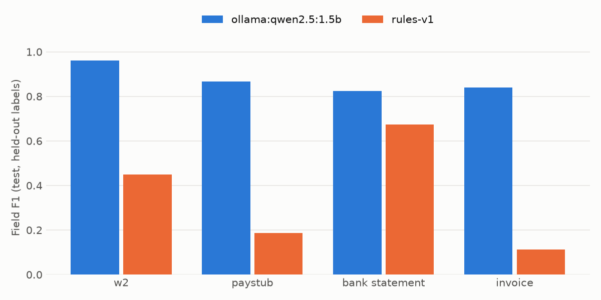

# Document Intelligence Engine

Reads financial documents (W-2s, pay stubs, bank statements, invoices), extracts validated structured data with per-field confidence and source boxes, and cross-checks documents within a case. PRD: [`../03-document-intelligence.md`](../03-document-intelligence.md). Synthetic data only; no real personal documents.

## Status

| Phase | State |
|---|---|
| 0. Setup and data | Synthetic generator, case-grouped frozen splits (hashed test manifest), Docker Compose (API, Redis, Postgres, MLflow), DVC pipeline (remote not yet configured). |
| 1. Baseline pipeline | Preprocess (native vs scanned, deskew, denoise), PyMuPDF layout + key-value pairing, keyword classifier, rules extractor, LLM extractor via Project 1 gateway, async REST API. |
| 2. Validation | Field rules (sums, formats) and cross-document case checks with readable reasons. |
| 3. Model race | Learned doc-type classifier (TF-IDF + logistic regression, DVC stage). Extractors: rules, Qwen2.5-1.5B on CPU via Ollama, Gemini / Groq / gateway adapters (run once keys are set). Leaderboard with F1, latency, tokens and cost. |
| 4–7 | Not started. |

## Quickstart

```bash
pip install -e ".[dev,ocr]"      # plus the Tesseract binary for scans
python scripts/make_data.py            # 60 cases (W-2 + pay stub + bank) + 60 invoices
python scripts/evaluate.py             # rules baseline on the frozen test split
python scripts/evaluate.py --model gemini-2.5-flash   # needs the Project 1 gateway (.env)
uvicorn docintel.api.main:app --port 8080
pytest -q
```

### Data versioning (DVC)

`dvc.yaml` defines two stages: `make_data` (driven by `params.yaml`) and `evaluate`. `dvc.lock` pins the exact dataset hash, and `reports/eval_rules-v1_test.json` is tracked as a DVC metric.

```bash
python -m dvc repro          # regenerate data + eval only if inputs changed
python -m dvc metrics show
python -m dvc pull           # DagsHub remote; needs a DagsHub token in .dvc/config.local (see below)
python -m dvc push
```

Remote credentials (never committed):

```bash
python -m dvc remote modify origin --local access_key_id <dagshub-token>
python -m dvc remote modify origin --local secret_access_key <dagshub-token>
```

API: `POST /documents?case_id=...` (multipart file) → `GET /jobs/{id}` → `GET /cases/{case_id}/check`.

## Benchmark design

- **Held-out label wording.** Splits are assigned per case before rendering. Test documents use wording from `HELDOUT_LABELS` (e.g. "Take-home pay" instead of "Net pay"), and no extractor may import that dictionary. Train and val documents use `LABELS`.
- **Scans.** 40% of documents are rendered at 200 dpi, rotated up to 3°, blurred, given noise and paper tone, and saved as JPEG-degraded PNGs.
- **Fonts.** Helvetica, Times and Courier are mixed.
- **No leakage.** A case's W-2, pay stub and bank statement are always in the same split, and the test manifest is SHA-256 hashed.

## Baseline results (rules-v1, measured)

| Split | Label wording | Native F1 | Scan F1 | Doc-type accuracy |
|---|---|---|---|---|
| val (40 docs) | seen | 1.00 | 0.83 | 100% |
| **test (50 docs)** | **held out** | **0.23** | **0.22** | **74%** |

Test F1 by type: W-2 0.45, pay stub 0.19, invoice 0.11, bank statement 0.00 (the keyword classifier misses every held-out bank statement). Cross-document check: 0 of 3 seeded inconsistencies caught on test, because the extracted fields it needs are missing.

**What this says:** OCR on scans costs about 17 F1 points. Unseen label wording costs almost everything. That gap is what the model race (Phase 3: LLMs, LayoutLMv3) and fine-tuning (Phase 4) must close, and these numbers are the bar to beat.

Latency on a 16-thread laptop CPU: native PDF p50 is about 27 ms. A single scan takes about 1.8 s warm, mostly Tesseract. With 16 parallel workers, scan p95 rises to about 12 s from CPU contention. Overall throughput is about 96 docs/min.

## Model race (Phase 3, test split, held-out label wording)



| Model | Field F1 | Native | Scan | Doc-type acc. | Cross-doc caught | p50 latency | Tokens in/out | Cost / 1K docs |
|---|---|---|---|---|---|---|---|---|
| Qwen2.5-1.5B (Ollama, CPU, zero-shot) | **0.88** | 0.89 | 0.87 | 100% | 2 of 3 | 23 s native, 29 s scan | 312 / 144 | $0 (local) |
| rules-v1 + learned classifier | 0.38 | 0.42 | 0.37 | 100% | 0 of 3 | <0.1 s native, ~2 s scan | – | $0 |

- **Classifier.** The learned classifier fixed document typing (74% to 100% on test) and lifted rules-v1 bank-statement F1 from 0.00 to 0.67.
- **Small model.** A 1.5B model with no training already beats rules by 50 F1 points on unseen wording. The cost is latency: about 25 s per document on this laptop CPU, with 2 parallel requests.
- **Review rate.** It is 78% for Qwen, because the model's self-reported confidence is uncalibrated and sits below the 0.85 auto-accept bar. Calibration and per-field thresholds are Phase 5.
- **API models.** Gemini and Groq are not on the board yet because no free-tier keys are configured. Add `GEMINI_API_KEY` / `GROQ_API_KEY` to `.env`, then run `bash scripts/race.sh`.
- **Cost.** API costs show "n/a" until list prices are filled in `docintel/eval/prices.py` for the run date.
- **Not used:** PyTorch CPU inference. Through `transformers` it ran about 30x slower than llama.cpp on this machine, so `hf:` is reserved for the Kaggle/Colab GPU in Phase 4.

Full table: [`reports/leaderboard.md`](reports/leaderboard.md).

## Layout

```
docintel/
  schemas.py          Pydantic schema per doc type; ExtractedField = value + confidence + bbox
  synth/              generator.py (ReportLab + Faker, ground truth JSON), split.py (frozen splits)
  pipeline/           preprocess.py, ocr.py, classify.py, run.py (process + confidence routing)
  extract/            rules.py, llm.py (OpenAI-compatible + HF local), registry.py (spec -> extractor)
  validators.py       field + cross-document rules
  eval/metrics.py     field-level P/R/F1
  api/main.py         FastAPI async jobs
scripts/              make_data.py, train_classifier.py, evaluate.py, leaderboard.py, race.sh
```
