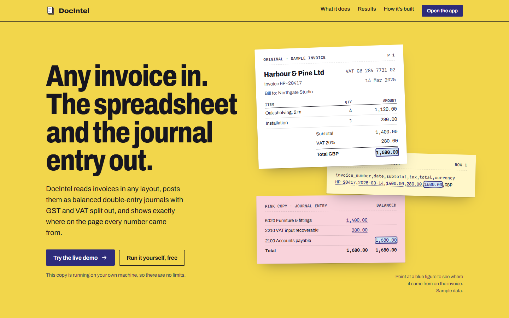
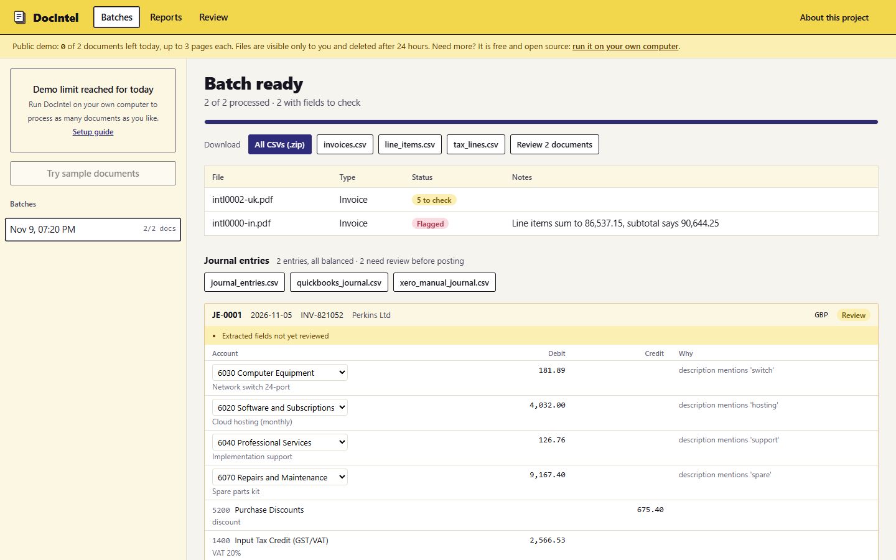
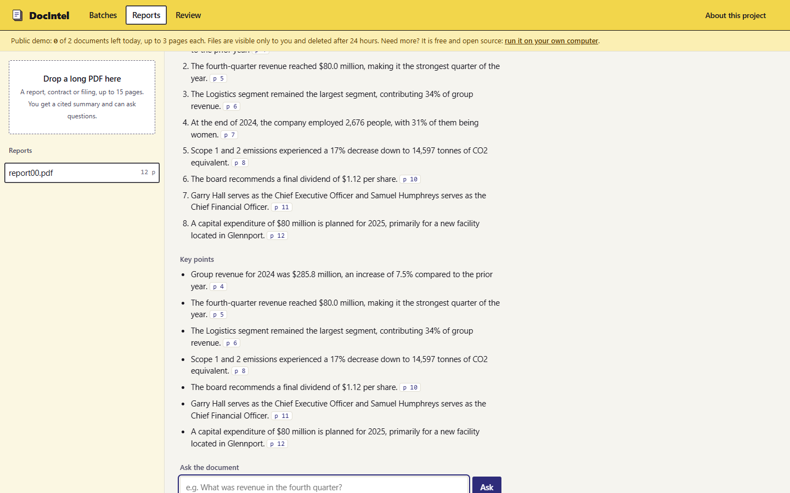
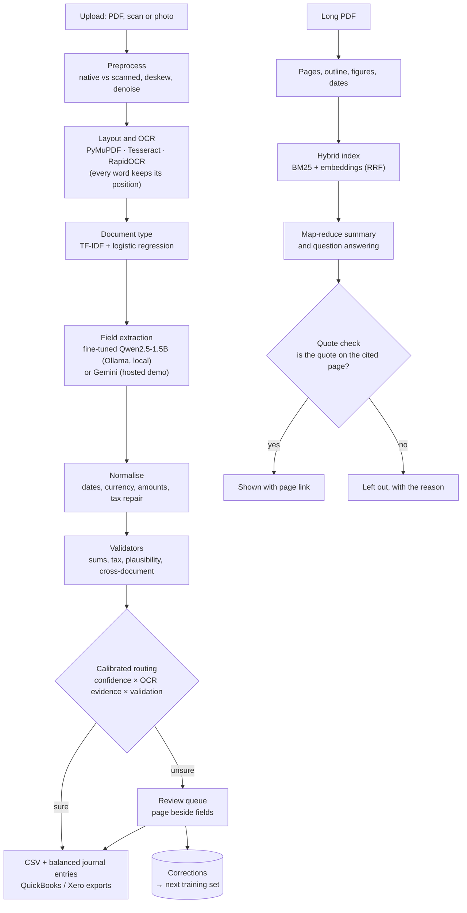
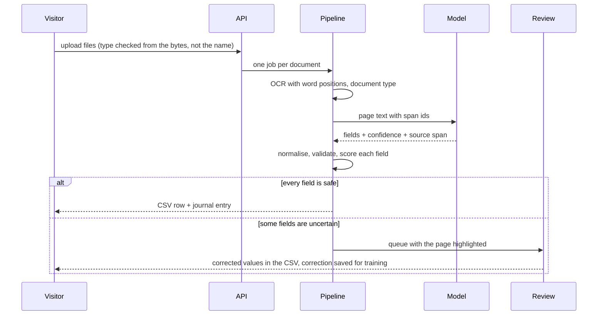
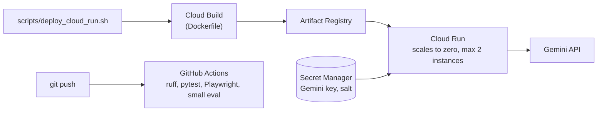

# DocIntel

**Any invoice in. The spreadsheet and the journal entry out, with every number traced back to the page.**

DocIntel is an open-source document intelligence engine. It reads invoices, receipts, W-2s, pay stubs and bank
statements in any layout, including tilted phone scans. It turns them into CSV files and balanced double-entry
journal entries with GST, VAT and sales tax split out. Every value is linked to the place on the page it came from,
and anything the system is unsure about goes to a person instead of being guessed. Long reports get a summary where
every sentence cites its page, and you can ask the document questions.

**Live demo:** https://docintel-408632234593.us-central1.run.app
(2 documents per visitor per day, no sign-up; the first load can take a few seconds while the server wakes up)

> The demo reads documents with Google's Gemini API, so please upload only sample or public documents. The
> open-source version runs entirely on your own computer with a fine-tuned local model, and documents never leave it.



---

## Contents
1. [Why it exists](#1-why-it-exists)
2. [What it does](#2-what-it-does)
3. [Results](#3-results)
4. [Architecture](#4-architecture)
5. [Stack, and why](#5-stack-and-why)
6. [How it works](#6-how-it-works)
7. [Trust: how errors are kept out](#7-trust-how-errors-are-kept-out)
8. [The model](#8-the-model)
9. [Deployment](#9-deployment)
10. [Run it locally](#10-run-it-locally)
11. [Testing](#11-testing)
12. [Repository layout](#12-repository-layout)
13. [Limits, stated plainly](#13-limits-stated-plainly)
14. [License and privacy](#14-license-and-privacy)

---

## 1. Why it exists

Finance teams still retype invoices. Every supplier lays one out differently, and scans arrive tilted and blurred.
Template-based tools break on each new layout, and a general chat model can return a confident number that is not on
the page. So someone keys the figures into a spreadsheet and then into the ledger, by hand.

DocIntel is built around three rules:

| Rule | What it means in the product |
|---|---|
| **No templates** | A model fine-tuned on varied layouts reads the page. It was tested on invoice designs it never saw in training |
| **Check before trusting** | Line items must add up to the subtotal, and subtotal plus tax must equal the total. A field that fails, or that the model is unsure of, goes to review |
| **Every number has a source** | Each value keeps the position of the words it was read from, so a reviewer confirms it at a glance, and every report sentence must quote its page |

## 2. What it does

| Area | What you get |
|---|---|
| **Batches** | Drop a folder of PDFs or photos. One CSV row per document, with line items, tax lines and bank transactions in their own files, and everything in one ZIP |
| **Journal entries** | Balanced double-entry journals (debits always equal credits) with input tax on its own account per type (GST, VAT, sales tax). Exports for QuickBooks and Xero. Remembers the account you choose for an item and explains why each line posts where it does |
| **Review** | A queue of documents with uncertain fields. The page image sits beside the fields, with each field's source highlighted. Keyboard-first on desktop; a page / fields switch on phones. Every correction is saved as training data |
| **Reports** | Upload a long PDF (a 70-page annual report or a contract). You get a plain-language description, a summary and key points, each citing its page, and you can ask questions. If the document does not say, the answer says so |
| **API** | Every screen is backed by a REST API (FastAPI), documented in the [user guide](docs/USER_GUIDE.md#11-use-it-from-a-script-api) |

| Batch with journal entries | Cited report summary |
|---|---|
|  |  |

## 3. Results

Every figure comes from a benchmark in `scripts/` that you can rerun. The local model is a 1.5-billion-parameter
model fine-tuned for this job; it runs free on a laptop CPU.

| Test | Result | Notes |
|---|---|---|
| 120 invoices in 8 page designs, 2 never seen in training | **0.97 field F1** | 0.99 and 0.98 on the two unseen designs |
| 45 international invoices (GST, VAT, sales tax; 5 currencies) | **0.98 field F1** | Includes tax lines and line items |
| 50 photographed shop receipts ([CORD](https://github.com/clovaai/cord), public) | **87% totals** | Subtotal 94%, tax 85%. Wrong totals are flagged for review |
| Fields accepted without review | **99.7% precise** | With 13% of fields sent to a person; raw model confidence gave 96.8% |
| Fine-tuning gain on unseen label wording | **0.88 → 0.97 F1** | Closed 80% of the gap to a hosted model; review rate 78% → 11% |
| Long-document questions, including unanswerable ones | **0 made-up answers** | 28 of 28 correct with Gemini on synthetic reports; on a real Federal Reserve report, 3 answered, 3 correctly refused, 0 wrong |

Small samples are reported as they are: treat differences of a few points as ties. Real, crumpled receipts remain
the hardest case (see [limits](#13-limits-stated-plainly)), which is why every uncertain field goes to review.

## 4. Architecture



## 5. Stack, and why

| Layer | Choice | Why |
|---|---|---|
| API | **FastAPI** | Typed, async, and one API serves the web app, scripts and tests |
| Reading pages | **PyMuPDF**, **Tesseract**, **RapidOCR** | PyMuPDF keeps each word's position on digital PDFs; OCR covers scans and photos |
| Local model | **Qwen2.5-1.5B + QLoRA**, served by **Ollama** (GGUF q8_0) | Small enough for a laptop CPU, free per document, and documents never leave the machine |
| Hosted model | **Gemini 3.5 Flash Lite** | Used by the public demo: about $0.004 per invoice and $0.05 per 70-page report |
| Training | **Kaggle T4** (free GPU), **MLflow**, **DVC** | Reproducible runs, tracked metrics, and a champion / challenger gate before any model is promoted |
| Long documents | **BM25 + nomic-embed-text** with reciprocal rank fusion | Keyword and meaning search together; works fully offline |
| Storage and jobs | **SQLite** or **Postgres**; **Redis + arq** optional | One file for a laptop install; a queue for multi-worker deployments |
| Front end | One HTML file, no build step | Fast to load and simple to self-host; designed for desktop and phone |
| Hosting | **Google Cloud Run** | Scales to zero when idle, so the demo costs about $0–2 a month |
| Tests | **pytest**, **Playwright**, **ruff** | Unit, API, security and real-browser tests on every push |

## 6. How it works

**A batch of invoices**



**Journal entries.** Each invoice becomes a purchase entry: expense lines by item (with a remembered account per
item), input tax by type, and accounts payable for the total. If the extracted figures do not reconcile, the
difference goes to a suspense account and the entry is marked for review rather than silently balanced.

**Long documents.** Pages are split into passages that keep their page numbers. The summary is written section by
section and then combined. Every statement must carry a quote. A statement is kept only when the quote is found on
the cited page and its numbers appear in that quote. Questions that the retrieved passages cannot answer get "the
document does not state this".

## 7. Trust: how errors are kept out

- **Validators:** sums, tax arithmetic, date and currency formats, and plausibility rules (tax above subtotal
  suggests swapped fields). A failed rule lowers the score of the fields involved.
- **Calibrated routing:** the model's own confidence is not trusted alone. Each field's score combines confidence,
  whether the value literally appears in the text it cites, and validation. Thresholds are fitted on held-out data
  for 99% precision, with a floor that never auto-accepts fields from a flagged document.
- **Citations that are checked, not just shown:** a report statement whose quote is not on the cited page is dropped
  and listed, with the reason.
- **No leakage in evaluation:** test documents use label wording the training data never contains, and the test
  manifest is hashed.
- **Honest promotion:** a retrain on real receipts raised receipt totals from 53% to 73% but lowered subtotal and tax
  accuracy on CORD, so it was **not** promoted. The comparison is in [QA_REPORT.md](docs/QA_REPORT.md).

## 8. The model

| | Zero-shot Qwen2.5-1.5B | **Fine-tuned (QLoRA)** | Gemini 3.5 Flash Lite |
|---|---|---|---|
| Test field F1 (unseen wording) | 0.878 | **0.968** | 0.995 |
| Scan F1 | 0.87 | 0.95 | 0.98 |
| Review rate | 78% | **11%** | 2% |
| Cost per 1,000 documents | $0 | **$0** | about $4 |
| Documents leave the machine | no | **no** | yes |

- **Data:** thousands of synthetic invoices and forms rendered in 8 layout families with scan noise, plus public
  receipt datasets. Training never sees the test label wording or the 2 held-out layout families.
- **Recipe:** 4-bit NF4 base, LoRA r=16 on all projections, loss on the answer only, seed 42. The training targets
  encode confidence (1.0 when the value is legible in the text, 0.5 when not), which is what makes routing work.
- **Serving:** merged, converted to GGUF q8_0 and served by Ollama. `python scripts/get_model.py` downloads it.

The phase-by-phase history (baseline, model race, fine-tuning, routing) is in
[docs/ENGINEERING_NOTES.md](docs/ENGINEERING_NOTES.md).

## 9. Deployment



- **Public demo limits:** no accounts. A visitor is an anonymous cookie, and limits also count a salted hash of the
  IP, so clearing cookies does not reset them. Each visitor gets 2 documents and 2 reports (up to 15 pages, 10 questions each) a
  day, with 150 documents a day in total. Files are visible only to their owner and deleted after 24 hours.
- **Security:** content security policy and related headers on every response. File types are checked from the
  bytes, and spreadsheet formula injection is neutralised in every CSV. Secrets live only in Secret Manager. Only
  the app code, Dockerfile and sample documents are uploaded to the build (`.gcloudignore`).
- **Cost:** about $0–2 a month at portfolio traffic, with a budget alert at $5.

## 10. Run it locally

You need Python 3.11+ and [Ollama](https://ollama.com).

```bash
git clone https://github.com/sivram04/doc-intelligence.git
cd doc-intelligence
python -m venv .venv && source .venv/bin/activate     # Windows: .venv\Scripts\Activate.ps1
pip install -e ".[local]"
python scripts/get_model.py                           # one time: downloads the model (~1.6 GB) into Ollama
docintel                                              # opens http://localhost:8030
```

Open **/app**, drop your files in **Batches** and click **All CSVs (.zip)**. No GPU is needed. To use Gemini instead
of the local model, set `GEMINI_API_KEY` and `EXTRACTOR=gemini:gemini-3.5-flash-lite` in `.env`.

The [user guide](docs/USER_GUIDE.md) covers each CSV's columns, reviewing, journal entries, long documents, model
choice, settings, the API, Docker and troubleshooting.

## 11. Testing

```bash
pip install -e ".[dev,ocr]"
python -m playwright install chromium
ruff check . && pytest -q
```

84 tests cover the pipeline, validators and accounting, the API, demo limits and visitor isolation, hostile
uploads, long-document citations, and real-browser flows on desktop and phone sizes. Accuracy benchmarks:

```bash
python scripts/evaluate.py --data data/synthetic_layouts --extractor ollama:docintel-qwen1.5b-ft-v5
python scripts/eval_cord.py --extractor ollama:docintel-qwen1.5b-ft-v5      # public CORD receipts
python scripts/eval_longdoc.py                                              # long-document citations
```

The full QA record, by area, is in [docs/QA_REPORT.md](docs/QA_REPORT.md).

## 12. Repository layout

```
docintel/
  pipeline/        preprocess, OCR, document type, processing and routing
  extract/         rules, LLM extractors (Ollama, Gemini, OpenAI-compatible), cascade, normalisation
  longdoc/         long-document reader, hybrid index, summary, questions, quote verification
  synth/           synthetic invoices, forms, layouts and reports with ground truth
  accounting.py    journal entries, tax accounts, account memory
  validators.py    field and cross-document rules
  routing.py       calibrated field scores and thresholds
  export.py        CSV and ZIP exports (formula-injection safe)
  api/             FastAPI app; static/ holds the landing page and the app (no build step)
scripts/           data generation, training, benchmarks and deployment
training/          QLoRA job (Kaggle) and Ollama Modelfile
samples/           synthetic invoices used by the demo's sample button
tests/             unit, API, security and browser tests
docs/              user guide, QA report, engineering notes
```

## 13. Limits, stated plainly

- **Real receipts are the hardest case.** On real Malaysian receipts ([SROIE](https://rrc.cvc.uab.es/?ch=13), public)
  the local model reads 53% of totals correctly (15 receipts; Gemini: 92.5% on 40), mostly because GST-inclusive
  totals are read as subtotals. Wrong totals are flagged, not hidden.
- **Benchmarks are mostly synthetic.** Layouts, noise and wording are varied on purpose and public datasets are added,
  but a company's own documents may differ. Measure on a sample before relying on it.
- **The local model is slow on a CPU:** about 20–60 seconds per document. Gemini is faster but sends documents to
  Google.
- **Journal entries are proposals.** They are balanced and explained, but someone should review them before posting.
- **Report answers can be incomplete.** They are limited to what the search retrieves, and every answer cites its
  pages so it can be checked.

## 14. License and privacy

- **License:** [Apache License 2.0](LICENSE)
- **Privacy:** [PRIVACY.md](PRIVACY.md) covers what the public demo stores and for how long. Self-hosted installs
  keep everything on your machine.
